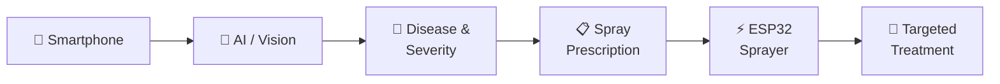

  <picture>
    <source media="(prefers-color-scheme: dark)"  srcset="./assets/plin.gif">
    <source media="(prefers-color-scheme: light)" srcset="./assets/light.gif">
    
  </picture>

  

    

  
  
  
  
  
  
  
  

 

## 👋 Hi, I'm Jiss

I'm an **MSc Computer Science (Data Analytics)** student from **India**. I like turning ideas into working projects, from data analysis and software to **AI, computer vision, automation and digital design**.

<table>
  <tr>
    <td width="50%" valign="top">

**🔭 Working on**
- 📊 Data analytics & visualization
- 🤖 AI & computer vision
- 🌱 Smart agriculture technology
- 🗄️ Database systems

</td>
    <td width="50%" valign="top">

**📚 Learning**
- 🐍 Python & SQL
- 🌐 Web development
- ⚡ Embedded systems
- 🎨 UI/UX design

</td>
  </tr>
</table>

---

## 🚀 Featured Project

<table>
  <tr>
    <td>

### 🌱 NovaKin
**AI-powered plant disease detection & targeted spraying**

A smartphone-assisted system that uses AI to estimate plant infection severity and turns it into a targeted spray prescription, so only the affected plants get treated.

</td>
  </tr>
</table>

---

## 🛠️ Tech Stack

<table>
  <tr>
    <td width="170"><b>Languages</b></td>
    <td>
      
      
      
    </td>
  </tr>
  <tr>
    <td><b>Web</b></td>
    <td>
      
      
      
    </td>
  </tr>
  <tr>
    <td><b>Data & Databases</b></td>
    <td>
      
      
      
    </td>
  </tr>
  <tr>
    <td><b>Design</b></td>
    <td>
      
      
      
    </td>
  </tr>
  <tr>
    <td><b>Platforms & Tools</b></td>
    <td>
      
      
      
      
      
    </td>
  </tr>
</table>

---

## 📊 GitHub Stats

  
  
   
  

<b>🐍 Contribution snake</b>

 

  

---

## 📫 Let's Connect

**Got an idea, a project or a dataset? Let's build something interesting together.**

📧 [jissabraham35@gmail.com](mailto:jissabraham35@gmail.com)

 

`Build` · `Learn` · `Experiment` · `Repeat`

⭐ Thanks for visiting my profile!

